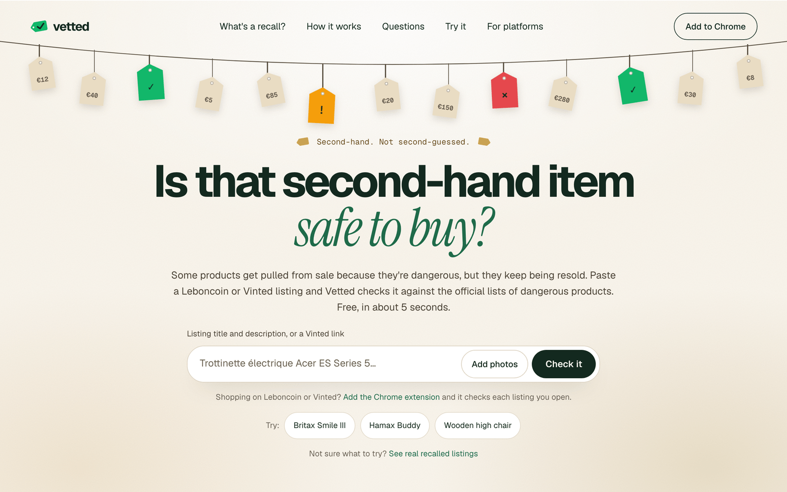
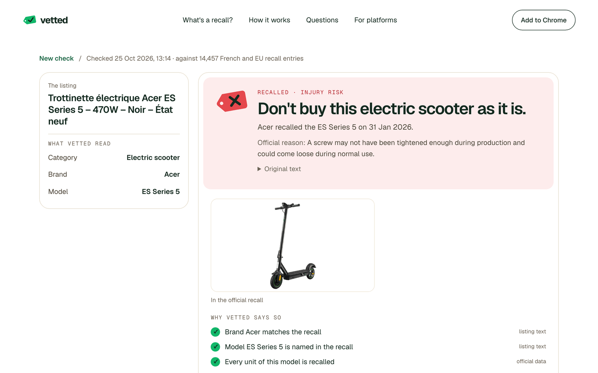
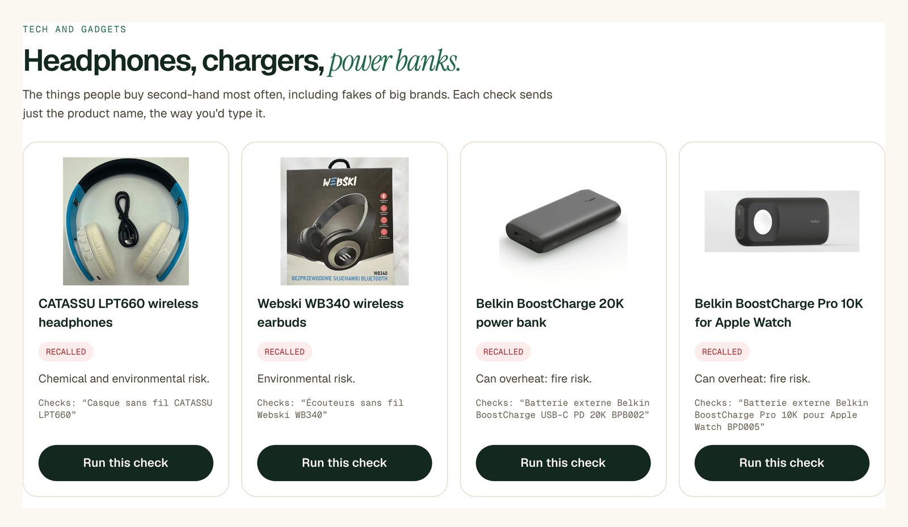

# Vetted

Vetted checks a second-hand listing (Leboncoin, Vinted and similar) against official product recalls from France
(RappelConso) and the EU (Safety Gate), and gives one of three answers: **recalled**, **check the label**, or
**no recall found**. Every answer links to the official notice.



- Live site: https://vetted.sheharyarishfaq.com
- Chrome extension: [download the zip](https://vetted.sheharyarishfaq.com/vetted-extension.zip), then follow the
  [install steps](https://vetted.sheharyarishfaq.com/how-it-works#extension). It shows the same check next to the
  Leboncoin or Vinted listing you're viewing.
- Try it: [/try](https://vetted.sheharyarishfaq.com/try) has one-click checks on real recalled products, from scooters
  and baby gear to headphones, chargers and power banks.
- For marketplaces: a demo JSON endpoint (`POST /api/v1/listings/check`, which returns the verdict and a suggested action)
  and a CSV bulk check, on [/platforms](https://vetted.sheharyarishfaq.com/platforms).



## How it works

AI reads, rules decide.

1. **Read.** A model (OpenAI Responses API, Structured Outputs, Zod schemas) turns the messy listing text and photos
   into fields: brand, model, product type, codes, barcode, batch, production date. Each field carries the quote it
   came from. Photos are compared with the recall's official photos.
2. **Find.** Candidate recalls come from several routes: exact codes and barcodes, fuzzy brand and model matching in
   Postgres (`pg_trgm`, `unaccent`), and embeddings. They are ranked together.
3. **Decide.** Plain, tested TypeScript in [`src/lib/verdict.ts`](src/lib/verdict.ts) compares those fields with the
   official data (models, codes, barcodes, batches, production dates, product types) and picks the answer. The model
   never outputs the verdict.

"No recall found" never means "safe". The answer says what was searched and shows the closest recall when one
came close. When only some units are recalled, Vetted writes the message to send the seller asking for a photo of
the label, in French and English.

## Try it

Most second-hand items have no recall, so "no recall found" is the usual answer. The [/try](https://vetted.sheharyarishfaq.com/try)
page lists real recalled products to check: listings saved from Leboncoin, tech items checked by name (including
counterfeit chargers and hair dryers), and Leboncoin and Vinted searches to open with the extension.



## Data sources

| Source | What | Licence |
|---|---|---|
| [RappelConso](https://rappel.conso.gouv.fr) | French product recalls, from the open data API | Licence Ouverte 2.0 (Ministère de l'Économie) |
| [EU Safety Gate](https://ec.europa.eu/safety-gate-alerts) | EU alerts on dangerous non-food products | European Commission reuse policy (Decision 2011/833/EU), with attribution |

14,457 recall entries are loaded. A daily job fetches new ones. Responses are cached, and Safety Gate gets at most
2 requests a second. Recall photos are shown from their official URLs. Vetted does not crawl marketplaces: the
extension reads only the listing the user is viewing.

## Results

**Evaluation** (`pnpm eval`): 74 real listings collected from Leboncoin and Vinted on 24 Oct 2026, labelled by hand,
run through the full pipeline.

- Correct: 74 of 74
- Flag precision: 15 of 15 flags name the expected recall
- Flag recall: 15 of 15 expected flags found

The first run, before the model-matching fixes, scored 67 of 74, with 8 of 15 expected flags found. Both runs are
recorded in [`content/eval/report.md`](content/eval/report.md).

**Self-test** (`pnpm selftest`): synthetic listings written from the recalls themselves. Listings that name a
recall's model, code or barcode must be flagged. Near misses, such as another model of the same brand or the same
model name under another brand, must not be.

- Rules only (fields given directly): 0 misses in 1,281 listings that name a recall, 6 false flags in 472 near misses
- Full pipeline (listings written as a seller would, read by the model): 4 misses in 96, 2 false flags in 51
- 10 of 10 previously wrong real cases now right

**Unit tests** (`pnpm test`): Vitest, covering the verdict rules, the parsers for both sources, and the copy built
from official data.

## Stack

- Next.js 16 (App Router), TypeScript in strict mode, Tailwind CSS 4
- PostgreSQL 17 with `pg_trgm` and `unaccent`, through Drizzle ORM
- S3-compatible storage for uploaded photos (MinIO locally), private, shown through presigned URLs
- OpenAI API with the official `openai` SDK and Zod for every model output
- Chrome extension: Manifest V3 with WXT, in [`extension/`](extension)
- Deployed on Railway

## Run it locally

You need Node 24, pnpm 10, Docker and an OpenAI API key.

```bash
pnpm install
cp .env.example .env.local        # then set OPENAI_API_KEY
docker compose up -d              # Postgres and MinIO
pnpm db:migrate
pnpm ingest                       # loads both recall sources; slow the first time
pnpm dev                          # http://localhost:3000
```

The ingest downloads the recall data. Two optional steps improve matching and call the OpenAI API for every recall,
so they cost money: `pnpm recalls:clean` (clean model and code fields) and `pnpm recalls:embed` (embeddings). Both
cache their results.

Other commands: `pnpm test`, `pnpm lint`, `pnpm typecheck`, `pnpm build`, `pnpm ext:build` (builds the extension
against the live site and zips it into `public/`), `pnpm ext:dev` (extension against `localhost:3123`).

## Licence

All rights reserved. The code is published to be read and evaluated, not reused. See [LICENSE](LICENSE).

Built solo at the OpenAI DevDay Community Hackathon Paris, 24–25 Oct 2026.
